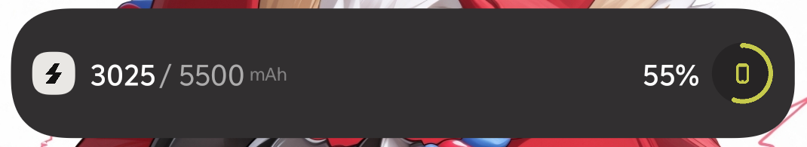

# Zmd Charge · 终末地电量桌面小组件

<p align="center">
  <a href="https://github.com/silicon-sbt/zmd-battery-widget/releases"></a>
  <a href="https://github.com/silicon-sbt/zmd-battery-widget/releases"></a>
  <a href="https://github.com/silicon-sbt/zmd-battery-widget/stargazers"></a>
  <a href="https://github.com/silicon-sbt/zmd-battery-widget/issues"></a>
  <a href="LICENSE"></a>
  
  
</p>

一个复刻《明日方舟：终末地》工业 / 超充风格的 **Android 电量桌面小组件**。深炭胶囊 HUD 实时显示当前电量、剩余 / 满充容量与充电状态，插入充电器时浮出终末地风充电动画。



## 下载

**最新版 v1.0.6.2**（正好 3.25 MB 的玩梗版）：

- [zmd-charge-v1.0.6.2.apk](https://github.com/silicon-sbt/zmd-battery-widget/releases/download/v1.0.6.2/zmd-charge-v1.0.6.2.apk)
- [Releases 全部版本](https://github.com/silicon-sbt/zmd-battery-widget/releases)

APK 内嵌的 HarmonyOS Sans SC 字体已做**子集化**（仅含本应用用到的字符），体积从约 20MB 降到 3MB，外观与完整字体一致。

## 功能

- **1×N 桌面小组件**：首次添加自动铺满整行，可拖动边缘调宽
- 复刻终末地「数字态」HUD：深炭胶囊、白色图标底板 + 深色闪电、**剩余 / 满充容量 + 百分比**、黄绿进度环
- **插电充电动画**：左发光闪电 + 「快充模式 / 充电中」，亮暗双帧脉冲约 3.2 秒后自动收回
- **「电量岛」**（可选，需授权）：插电时状态栏下方浮出一条终末地风 HUD —— `/// 超充模式` 展开 → 收成胶囊 → 约 6 秒收回；桌面 / 任意 App 上都可见
  - 需授予「显示在其他应用上层」（设置页有入口）；可调**不透明度**；支持**预览**
- 充电时进度环变**绿色**（#4CD964），未充电为**黄绿**（#C6CA4C）
- **低电量**数字变红；**满充容量**自动按机型查表，支持**手填覆盖**
- 点击组件进入**终末地风设置页**（原生 Android 偏好 + 深炭 / 黄绿主题）
- **运行日志**：记录插拔电 / 电量 / 渲染 / 服务 / 崩溃堆栈，可分享 / 复制 / 清空
- 字体：鸿蒙开源字体 **HarmonyOS Sans SC**

## 主题色板（Endfield 实测）

| 元素 | 色值 |
|---|---|
| 深炭胶囊 | `#312F30` |
| 黄绿电光（环 / 闪电 / 徽章） | `#C6CA4C` |
| 低电量红 | `#FF4D4F` |
| 图标底板米白 | `#E9E7E4` |
| 主文字白 | `#FFFFFF` |

## 电量数据怎么算

- 百分比：`ACTION_BATTERY_CHANGED` 的 `EXTRA_LEVEL / EXTRA_SCALE`
- 剩余容量：用 `百分比 × 满充设计容量` 推算；若 `CHARGE_COUNTER` 读数与推算吻合（±25%）则优先采用，避免机型读数跳变
- 满充容量优先级：**手填「标称容量」 > 内置容量表 > 远程容量表 > 默认 5500 mAh**，均可在设置页覆盖

## 一些已知限制（真机实测：iQOO V2403A / OriginOS 6 / Android 16）

- **锁屏上看不到「电量岛」** —— 第三方悬浮窗位于系统锁屏层之下，Android 硬限制，无 root 无法绕过。息屏插电只播系统自己的充电动画，解锁后可能看到岛的尾巴。
- **部分国产 ROM 会冻结后台** —— 静置后 App 可能被系统放入冻结名单，冻结期间连广播都收不到。这不是 bug，是 ROM 后台策略；设置页 → 后台运行 → **「后台保活自检」** 会提示风险并一键跳转白名单设置。详见 `docs/安卓冻结机制调研.md`。

详细技术解析见 `docs/` 目录（冻结机制、充电动画方案、灵动岛方案调研）。

## 兼容性

不保证适配所有机型 / ROM —— 国产系统对后台运行、悬浮窗、通知的策略差异很大。常见情况：

- 插电不弹岛 / 弹了看不到 → 多半是**没给悬浮窗权限**，或 App 被系统冻结（需加后台白名单 / 自启动）
- 岛看起来半透明 → 已用多层叠加修复，若仍异常请反馈
- 容量 / 电量数字不对 → 可在设置页手填「标称容量」，或反馈机型让我补表

**遇到问题请到 [Issues](https://github.com/silicon-sbt/zmd-battery-widget/issues) 反馈**，附上：机型、系统版本、以及 **设置页 → 诊断 → 运行日志 → 分享** 的内容。会持续修。

## 构建

要求：Android SDK 35、Gradle 8.11.1、JDK 17+（仓库已配 `android.overridePathCheck=true` 兼容含中文目录名）。

> 字体（HarmonyOS Sans SC，约 24MB）不进 git，首次构建前先运行：
> ```powershell
> .\fetch-fonts.ps1
> ```

```bash
gradle assembleDebug   # 产物：app/build/outputs/apk/debug/app-debug.apk
```

也可用 Android Studio 直接打开工程运行。

## 安装

1. 安装 [最新 Release APK](https://github.com/silicon-sbt/zmd-battery-widget/releases)（覆盖安装即可，不清数据；自签名 / 国产 ROM 需允许「未知来源安装」）
2. 长按桌面 → 小部件 → 找到 **「终末地电力」** 拖到桌面
3. 若刷新不及时：系统设置里将本应用设为「后台不限制 / 允许自启动」

## 设备容量表

内置容量表约 **600 条**，覆盖 iQOO / vivo、华为 / 荣耀、三星、Pixel、小米 / 红米 / POCO、OPPO / 一加 / realme、摩托罗拉 / 索尼 / 华硕 / 努比亚 / 红魔 / 魅族等主流机型，**可云端自动更新**（12 小时节流，补机型 / 改容量不用发新版）。

匹配规则：机型代码按**词边界匹配**防止误命中（`PLU110` 不再命中 `u1`、`x9` 不再命中 `SM-X910`）。机型被认错时，直接在设置页填「标称容量」即可覆盖。

## 更新日志

<details>
<summary>展开历史版本</summary>

### v1.0.6.2
- **安装包精确做成 3.25 MB**（3,407,872 字节），纯玩梗，功能与 v1.0.6.1 相同 —— 详见下方「彩蛋」章节

### v1.0.6.1
- **修复「应用外插电有时不弹岛」**：删除一处自己加的前台判断（vivo 下按 HOME 后 Activity 回调延迟，导致误判「还在前台」而静默跳过）
- **新增设置页「后台保活自检」**：显示电池优化豁免 + 系统待机桶，有冻结风险时一键跳转白名单设置

### v1.0.6
- **新增「电量岛」**：插电时在状态栏下方浮出终末地风 HUD（`/// 超充模式` 展开 → 收成胶囊 → 约 6 秒自动收回）
  - 悬浮窗实现，桌面与任意 App 上可见；需要「显示在其他应用上层」授权
  - 可调不透明度 + 预览按钮
- 修复国产 ROM 把第三方悬浮层按约 0.8 合成导致的「蒙灰」半透明（同内容叠 3 层窗口，等效 ≈0.99）
- 打开应用时自动拉起前台服务（重装 / 被杀后自愈）

### v1.0.5
- **容量表支持云端自动更新**（12 小时节流，失败静默回退内置表）；Redmi K 系列 / Turbo 全系补全（49 条）

### v1.0.4
- 修复容量识别被「短键」误命中（改名**词边界匹配**）；新增一加 Turbo 6 等机型；手填容量可强制优先

### v1.0.3
- 组件宽度（1×N，可调 1~6 格）；诊断运行日志；修复荣耀 X10 插电瞬间组件异常

### v1.0.2
- 前台服务实时刷新；快充按充电电流判定；拔电 5 秒锁定

### v1.0.1
- 充电时进度环变绿；修复进度环方向；设置页「检查更新」

</details>

## 彩蛋：为什么安装包是 3.25 MB

> 因为 325 是个梗。

**出处**：2024 年 3 月 11 日，明日方舟 UP 主 **魔法ZC目录** 在民间赛事「仙术杯」第五届代表**冠军厨小队**出战，使用**科学分队 · 焰影苇草**开局，在第三层关底「利刃所指」暴毙，**局内结算 325 分**。这个成绩低得离谱，于是「325」成了圈内梗，连鹰角自己也在《终末地》里埋过 325 的彩蛋。

本项目是终末地风电量 HUD，把安装包大小做成 **3.25 MB** 算是一种致敬（`app/src/main/assets/pad.bin` 是那个填充文件，不参与运行）。

> GitHub 显示文件大小按 1024 进制算（`3,407,872 ÷ 1,048,576 = 3.25`），所以下载页会显示 **3.25 MB**。

## 致谢

视觉风格**强烈参考并复刻**自 [QinAnze/zmd-charge](https://github.com/QinAnze/zmd-charge)（Windows 端终末地风电量 HUD，**MIT**）。非常感谢原作者开源，让我能把这份好看的「终末地工业 / 超充」设计用在安卓小组件上。底层逻辑（电量读取、桌面组件、设置页、充电动画）为本项目原创。

「电量岛」的 HUD 时间线与渲染复用了 [NingmengLemon/EndfieldChargingAnim](https://github.com/NingmengLemon/EndfieldChargingAnim)（原 Xposed 模块，已改 **MIT**），非常感谢作者开源，让非 root 安卓端也能用上这套 HUD。

字体使用 **HarmonyOS Sans SC**（[ajacocks/harmonyos-sans-font](https://github.com/ajacocks/harmonyos-sans-font)，HUAWEI 开源、免费商用）。

## 支持这个项目

业余时间**免费维护**，无广告、无追踪、无内购，源码完全公开（MIT）。

比起赞助，下面这些「不要钱」的支持更实在：

- 点个 **Star**，让更多需要的人搜得到
- 遇到问题提 [**Issue**](https://github.com/silicon-sbt/zmd-battery-widget/issues)（附机型 / 系统版本 / 运行日志），帮我把适配做扎实
- 帮忙**补容量表** —— 你的机型没识别对，把「设置页 → 标称容量」的正确值和机型名发我
- 进 QQ 群 **1001632909** 反馈、聊天都行

<p align="center">
  <sub>如果你确实想请作者喝杯奶茶，下面这个码随时都在 —— 但真的不必勉强</sub>
</p>

<p align="center">
  
</p>

## 交流

QQ 群：**1001632909** —— 反馈机型适配、补容量表、提建议都欢迎，也可以直接在 [Issues](https://github.com/silicon-sbt/zmd-battery-widget/issues) 提。

## 许可

本项目采用 **MIT License**，见 [LICENSE](LICENSE)。